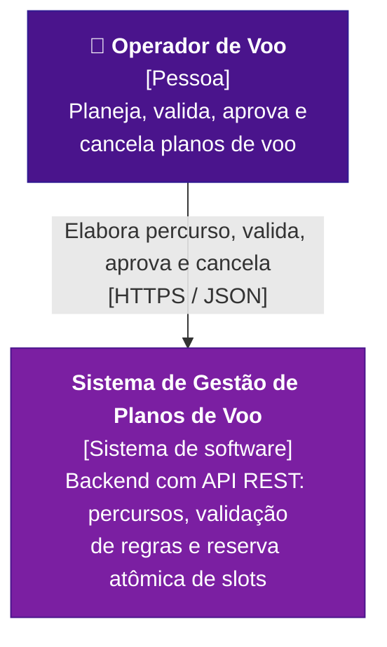
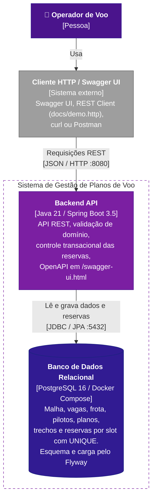
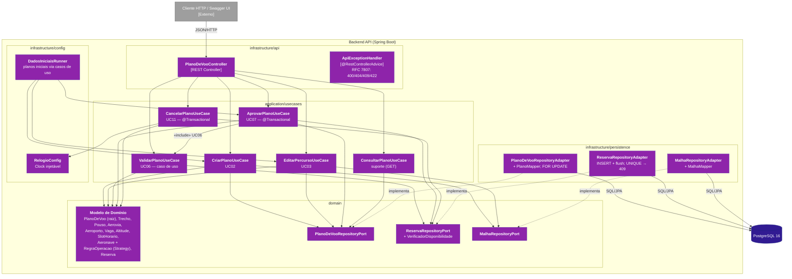
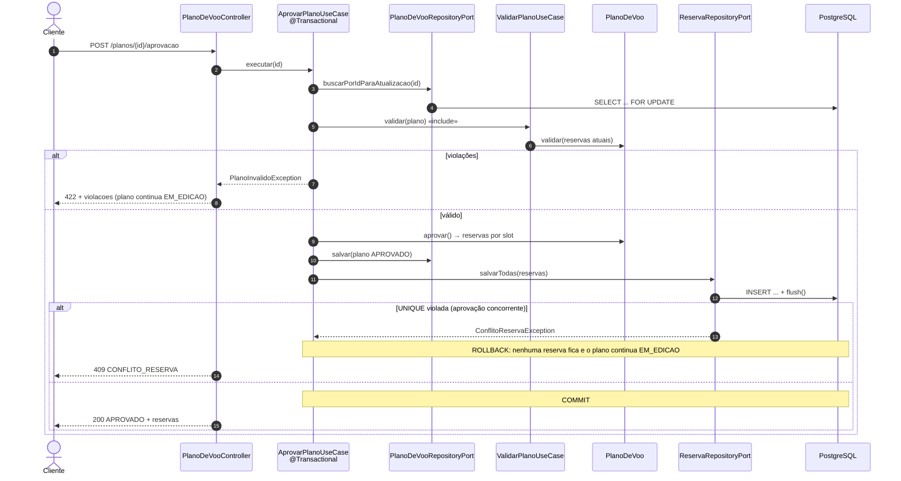

# Arquitetura — modelo C4 (versão implementada)

Este documento **substitui as seções 3.3 e 3.4** de [`arquitetura.pdf`](arquitetura.pdf). Os diagramas
abaixo correspondem ao código desta entrega. As fontes PlantUML (C4-PlantUML, mesmo estilo do PDF) estão em
[`c4/`](c4/); as versões em Mermaid aparecem aqui para o GitHub renderizar.

**Correções em relação ao PDF de 7/10:**

1. **Nível 2:** a SPA saiu da fronteira do sistema. O escopo do trabalho é só o backend, então o cliente
   aparece como sistema **externo**, "Cliente HTTP / Swagger UI".
2. **Nível 3:** `ValidarPlanoUseCase` é um **caso de uso** da camada de aplicação, não um "Domain Service".
   A regra de validação mora no domínio (`PlanoDeVoo.validar`), e o caso de uso só a orquestra.
3. **Nível 3:** os componentes são exatamente as classes e os pacotes implementados. `MalhaRecursosController`
   e `ConsultarMalhaUseCase` (UC01, UC04 e UC05) saíram do diagrama porque ainda não fazem parte desta
   entrega. Entraram `ApiExceptionHandler`, `ConsultarPlanoUseCase`, os adaptadores de persistência,
   `RelogioConfig` e `DadosIniciaisRunner`.

O estilo arquitetural é o do PDF (seção 3.1): **Clean Architecture / Ports and Adapters**. As dependências
apontam para dentro (`infrastructure → application → domain`), e o domínio não depende de Spring nem de
JPA.

## Nível 1 — Contexto

Fonte: [`c4/nivel1-contexto.puml`](c4/nivel1-contexto.puml)

Não há sistemas externos integrados. Malha, frota e pilotos são dados do próprio sistema, carregados por
script (ver decisão I1 em [`decisoes.md`](decisoes.md)).

## Nível 2 — Contêineres

Fonte: [`c4/nivel2-containers.puml`](c4/nivel2-containers.puml)

| Contêiner | Tecnologia | Responsabilidade |
|---|---|---|
| Backend API | Java 21, Spring Boot 3.5 (Web, Data JPA, Validation), springdoc-openapi, Flyway | Expõe os casos de uso, aplica as regras do domínio, delimita as transações de aprovação e cancelamento, aplica as migrações e a carga inicial ao subir. |
| Banco de dados | PostgreSQL 16 em `docker-compose.yml`, volume `pgdata` | Persistência durável. As restrições `UNIQUE (aerovia_id, altitude_pes, slot_inicio)` e `UNIQUE (vaga_id, slot_inicio)` garantem a exclusividade dos recursos. |

## Nível 3 — Componentes da Backend API

Fonte: [`c4/nivel3-componentes.puml`](c4/nivel3-componentes.puml)

### Componentes e pacotes

| Pacote | Componente | Responsabilidade |
|---|---|---|
| `infrastructure/api` | `PlanoDeVooController` | Converte HTTP em chamadas aos casos de uso. Sem regra de negócio. |
| `infrastructure/api/exception` | `ApiExceptionHandler` | Exceções de domínio → `ProblemDetail` com `codigo` estável. |
| `application/usecases` | `CriarPlanoUseCase` | UC02. Resolve piloto, aeronave e aeroportos (404) e chama `PlanoDeVoo.criar`. |
| | `EditarPercursoUseCase` | UC03. Resolve aerovia e vaga (404) e chama `adicionar/alterar/removerTrecho`. |
| | `ValidarPlanoUseCase` | UC06. Executa `PlanoDeVoo.validar` contra as reservas atuais, sem gravar nada. |
| | `AprovarPlanoUseCase` | UC07. Numa transação: bloqueia o plano, revalida (UC06), grava as reservas com flush e aprova. |
| | `CancelarPlanoUseCase` | UC11. Numa transação: `cancelar(agora)`, remove as reservas e grava a situação. |
| | `ConsultarPlanoUseCase` | Suporte à demonstração: `GET /planos/{id}`. |
| `application/dto` | `request/*`, `response/*` | Contratos da API (records com Bean Validation). |
| `domain/model` | Entidades e objetos de valor | Regras de percurso, horário, autonomia, slots e ciclo de vida. |
| `domain/model/aeronave` | `Aeronave`, subclasses, `RegraOperacao` e implementações | Regras por categoria (Strategy). |
| `domain/model/reserva` | `Reserva`, `ReservaAerovia`, `ReservaVaga` | Ocupação por slot. |
| `domain/repository` | Portas | Interfaces implementadas pela persistência. |
| `domain/exception` | Exceções de domínio | Sem dependência de HTTP. O mapeamento para status fica na API. |
| `infrastructure/persistence` | `entities`, `repositories`, `adapters`, `mappers` | JPA separado do domínio. |
| `infrastructure/config` | `RelogioConfig`, `OpenApiConfig`, `DadosIniciaisRunner` | Beans, documentação OpenAPI e carga inicial. |

### Dinâmica da aprovação (UC07)

## Correspondência com o modelo de domínio do PDF

O modelo de domínio da seção 2.1 do PDF foi implementado como está, com estes acréscimos de implementação:

| Elemento | Motivo |
|---|---|
| `Violacao` e `CodigoViolacao` | Detalham os `erros[]` de `ResultadoValidacao` (código, trecho e mensagem). |
| `AltitudesPermitidas`, `AltitudeMinima`, `JanelaHoraria` | Implementações da `RegraOperacao` para as três categorias. |
| `VerificadorDisponibilidade` | Porta que a validação usa para consultar a ocupação atual, sem depender de JPA. |
| Exceções em `domain/exception` | Representam falhas de regra (404/409/422) sem conhecer HTTP. |
